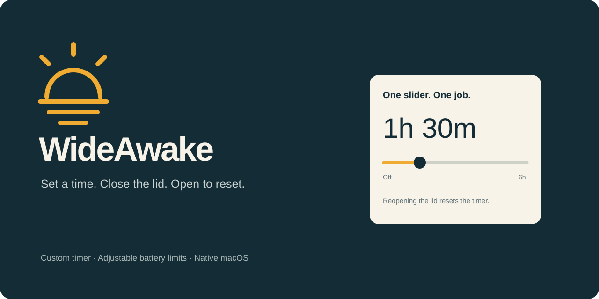
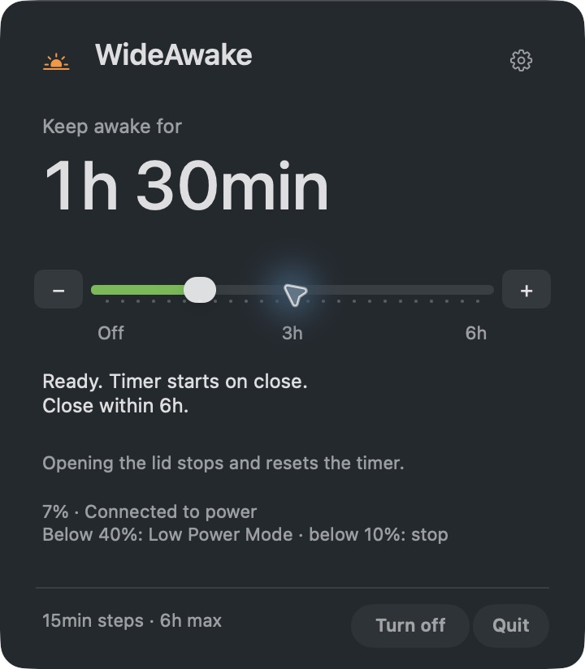
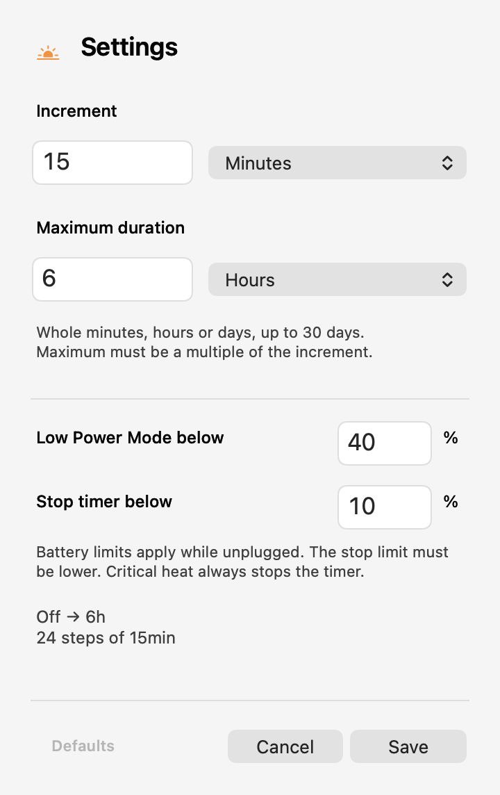

<p align="center"></p>

<p align="center"><a href="https://github.com/nazeeh111/WideAwake/releases/tag/v0.3.0">Download preview</a> · <a href="#install">Install</a> · <a href="#how-it-works">How it works</a> · <a href="LICENSE">MIT license</a></p>

WideAwake is a small native macOS menu bar timer for keeping a MacBook awake with the lid closed. Choose a duration using a slider you can customize. The defaults are **15-minute steps up to 6 hours**. Reopening the lid stops the timer and resets the slider to Off.

<p align="center"></p>

This preview has checked native panels and controlled power-state behavior. **Physical closed-lid operation still needs hardware validation.** [Verification record](docs/VERIFICATION.md).

## Use it

1. Click the sunrise in the menu bar.
2. Move the slider to a duration and wait for **Ready**.
3. Close the lid. The selected time starts then.
4. Open the lid to stop and reset. Choose another time when you need it.

Move the slider to **Off** to cancel at any time. If you leave it ready with the lid open, it disarms after six hours, or the configured maximum if that is shorter. Expiry while closed restores normal sleep behavior.

## Your timer. Your battery limits.

Open the **gear** to edit timer increments, maximum duration and both battery limits in one native panel. Timer durations use minutes, hours or days. Choose positive whole numbers, from 1 minute to 30 days. The maximum must be a multiple of the increment, so every step is exact. A preview shows the resulting range and step count before you save.

Settings persist across restarts. **Defaults** restores 15-minute steps, a 6-hour maximum and the 40% / 10% battery limits. Turn the timer off before changing its range. The − and + buttons make precise selections easy, including when a large range has too many steps to show individual ticks.

<p align="center"></p>

### Battery behavior, explained

| Setting | Default | What happens while unplugged |
| --- | --- | --- |
| Low Power Mode below | 40% | Enables battery Low Power Mode while a timer is armed or running. |
| Stop timer below | 10% | Ends the timer and restores normal sleep. |

Both percentages are editable. Use 1–100% for Low Power Mode and 1–99% for stopping, with the stop limit lower than the Low Power Mode limit. For example, choose **25% / 5%** to keep using the timer below 10%. Limits are strict: a 10% stop limit stops at 9%, not at 10%.

Connecting power bypasses the battery stop limit. Critical heat still ends a timer. If starting is blocked, the panel explains the reason and how to proceed. Reconnect power or lower your stop limit, then select a duration again. If a safeguard ends a timer, its reason stays visible. **Retry** appears when power settings still need restoring.

WideAwake preserves Low Power Mode if you already had it enabled before the timer. Changes it makes are recorded before they happen and undone when the session ends.

WideAwake stays in the menu bar, including while editing settings. No Dock icon or separate settings window. The native panel follows your Mac’s [light or dark appearance](docs/panel-dark.png). Click away or press Escape to dismiss the panel.

## Install

**Apple Silicon · macOS 26 or later.** The preview download includes the app and installer. A source build requires Swift 6.2 or later.

Download and unpack the [latest release](https://github.com/nazeeh111/WideAwake/releases), then run these commands inside the unpacked folder:

```sh
./scripts/install.sh --app ./WideAwake.app
```

On first installation, the installer asks for an administrator password to grant exactly four power commands: enable/disable sleep prevention and enable/disable battery Low Power Mode. Updates reuse those grants after checking all four, without rewriting the permission rules. It installs the app in `~/Applications`, a recovery job in your user account, and support files in `~/Library/Application Support/WideAwake`. The app registers with macOS Open at Login. Notifications are optional.

This preview is locally signed, **not Apple notarized**. If macOS blocks it, review the source and use the normal Privacy & Security controls if you choose to proceed. The installer verifies the bundle signature before replacing an installation. Keep the unpacked folder for uninstalling.

To build and install from source:

```sh
git clone https://github.com/nazeeh111/WideAwake.git
cd WideAwake
./scripts/install.sh
```

To remove it and restore power settings:

```sh
./scripts/uninstall.sh
```

Quit any other utility that controls lid sleep before using WideAwake.

## How it works

The timer prepares a bounded sleep guard before the lid closes, then sets the full selected deadline on the close event. Opening the lid releases the guard and restores saved settings. A journal and an independent recovery job handle interrupted restoration and app crashes.

The interface uses AppKit, a static icon and native controls. There is no animation or live seconds counter. Lid, power and thermal events drive the active session; brightness is sampled every 30 seconds while active. The recovery job checks at a 60-second interval. WideAwake does not inspect other apps, chats, files or browsing activity. It makes no network requests and contains no analytics.

Battery and thermal safeguards remain enabled. Your saved battery limits control Low Power Mode and the early stop. These protections can end a timer early. Keep the MacBook ventilated while it is running closed; keeping the computer awake necessarily uses more energy than sleep.

## Verification

Release tests cover timer selection, custom battery boundaries, plugged-in behavior, reconnect-and-retry, settings persistence, failed saves, native form validation, recovery retries, close/open cycles and restoration. The timer image is captured from the installed 0.3.0 app; the settings and state examples are rendered from the same AppKit views using disposable state and simulated hardware. See [verification details](docs/VERIFICATION.md) and [changes in 0.3.0](CHANGELOG.md).

Physical closed-lid behavior across Mac models, external displays and other sleep utilities still needs hardware feedback. This remains a preview.

```sh
swift test -c release
python3 scripts/tests/test_install_replacement.py
python3 scripts/tests/test_install_permissions.py
./scripts/package.sh
```

Packaging creates a locally signed app and installer zip in `dist/`; it does not install anything. To regenerate panel images from the shipping views:

```sh
WIDEAWAKE_CAPTURE_DIR=/tmp/wideawake-panels swift test -c release --filter PanelPresentationTests
```

## Earlier demo

The 0.2.0 clip shows the original timer and custom ranges. Use the screenshots above for the current battery controls.

[Watch the 21-second demo](https://github.com/nazeeh111/WideAwake/releases/download/v0.2.0/WideAwake-demo.mp4). It uses actual interface captures, with a silent edit and sharp cuts. The source composition lives in [`brag-output`](brag-output).

<a id="credits"></a>

## License

[MIT license](LICENSE).
