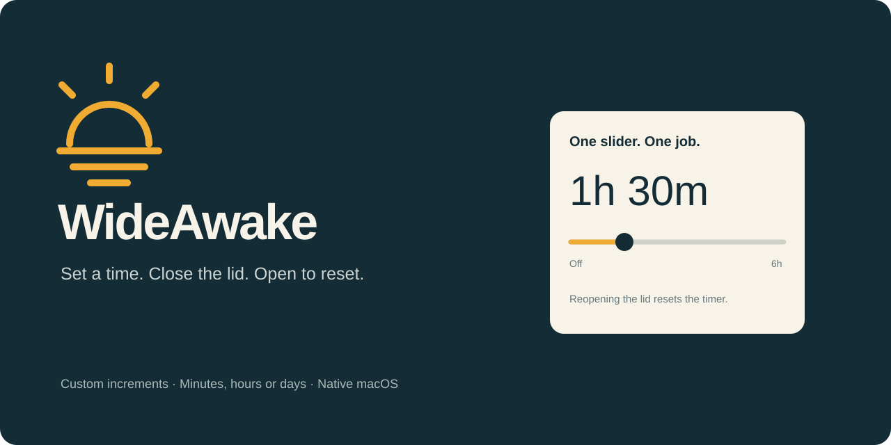
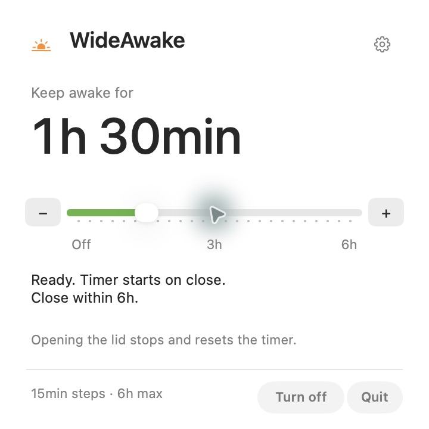
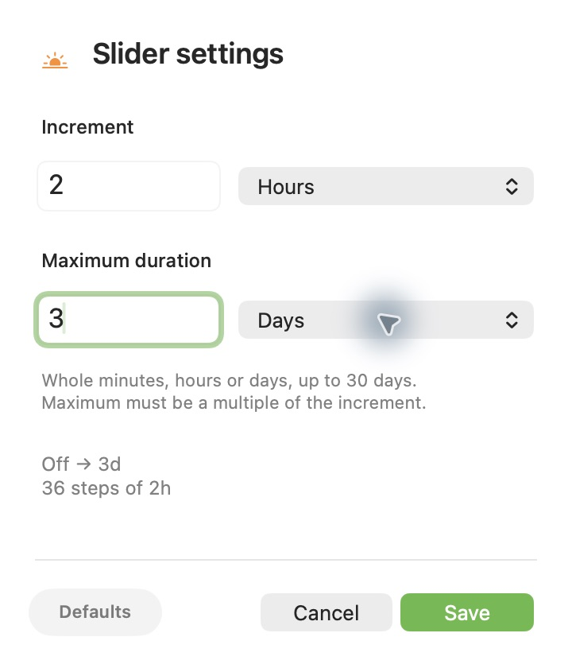

<p align="center"></p>

<p align="center"><a href="https://github.com/nazeeh111/WideAwake/releases/tag/v0.2.0">Download preview</a> · <a href="#install">Install</a> · <a href="#how-it-works">How it works</a> · <a href="LICENSE">MIT license</a></p>

WideAwake is a small native macOS menu bar timer for keeping a MacBook awake with the lid closed. Choose a duration using a slider you can customize. The defaults are **15-minute steps up to 6 hours**. Reopening the lid stops the timer and resets the slider to Off.

<p align="center"></p>

## Use it

1. Click the sunrise in the menu bar.
2. Move the slider to a duration and wait for **Ready**.
3. Close the lid. The selected time starts then.
4. Open the lid to stop and reset. Choose another time when you need it.

Move the slider to **Off** to cancel at any time. If you leave it ready with the lid open, it disarms after six hours, or the configured maximum if that is shorter. Expiry while closed restores normal sleep behavior.

## Make it yours

Open the **gear** in the panel to set the increment and maximum using minutes, hours or days. Choose positive whole numbers, from 1 minute to 30 days. The maximum must be a multiple of the increment, so every step is exact. A preview shows the resulting range and step count before you save.

See a [three-day selection](docs/panel-custom.png). Settings persist across restarts. **Defaults** restores 15-minute steps and a 6-hour maximum. Turn the timer off before changing its range. The − and + buttons make precise selections easy, including when a large range has too many steps to show individual ticks.

<p align="center"></p>

WideAwake stays in the menu bar, including while editing settings. No Dock icon or separate settings window. The native panel follows your Mac’s [light or dark appearance](docs/panel-dark.png). Click away or press Escape to dismiss the panel.

## Install

**Apple Silicon · macOS 26 or later.** The preview download includes the app and installer. A source build requires Swift 6.2 or later.

Download and unpack the [latest release](https://github.com/nazeeh111/WideAwake/releases), then run these commands inside the unpacked folder:

```sh
./scripts/install.sh --app ./WideAwake.app
```

The installer asks for an administrator password to grant exactly four power commands: enable/disable sleep prevention and enable/disable battery Low Power Mode. It installs the app in `~/Applications`, a recovery job in your user account, and support files in `~/Library/Application Support/WideAwake`. The app registers with macOS Open at Login. Notifications are optional.

This preview is locally signed, **not Apple notarized**. If macOS blocks it, review the source and use the normal Privacy & Security controls if you choose to proceed. The installer verifies the bundle signature before replacing an installation. Keep the unpacked folder for uninstalling.

To build and install from source:

```sh
git clone https://github.com/nazeeh111/WideAwake.git
cd WideAwake
./scripts/install.sh
```

To remove it and restore power settings:

```sh
./scripts/uninstall.sh
```

Quit any other utility that controls lid sleep before using WideAwake.

## How it works

The timer prepares a bounded sleep guard before the lid closes, then sets the full selected deadline on the close event. Opening the lid releases the guard and restores saved settings. A journal and an independent recovery job handle interrupted restoration and app crashes.

The interface uses AppKit, a static icon and native controls. There is no animation or live seconds counter. Lid, power and thermal events drive the active session; brightness is sampled every 30 seconds while active. The recovery job checks at a 60-second interval. WideAwake does not inspect other apps, chats, files or browsing activity. It makes no network requests and contains no analytics.

Battery and thermal safeguards remain enabled. At low battery it can enable Low Power Mode; at the stop threshold it restores normal sleep. These protections can end a timer early. Keep the MacBook ventilated while it is running closed; keeping the computer awake necessarily uses more energy than sleep.

## Preview status and verification

The initial preview has **141 passing tests**, covering timer selection, close/open cycles, repeated use, bounded waiting, recovery, failed restoration and power rules. The installed interface was exercised with the default range and a custom two-hour increment / three-day maximum. Keyboard editing, unit menus, invalid ranges, persistence, precise stepping and Turn off were checked. macOS reported the menu bar utility role while the panel was open. Enabling and releasing the power guard was verified on the development Mac.

A physical closed-lid test was not performed for this release. Behavior across Mac models, external displays and other sleep utilities still needs hardware feedback. This is a preview, not a claim of universal hardware compatibility.

```sh
swift test -c release
python3 scripts/tests/test_install_replacement.py
```

## Demo

[Watch the 21-second demo](https://github.com/nazeeh111/WideAwake/releases/download/v0.2.0/WideAwake-demo.mp4). It uses actual interface captures, with a silent edit and sharp cuts. The source composition lives in [`brag-output`](brag-output).

## Credits

WideAwake is derived from [Krish Garg’s Insomnia](https://github.com/krishhgg/Insomnia), version 0.1.0. Its power recovery foundation is retained under the MIT license. WideAwake adds a manual lid-cycle controller, a smaller native interface, a new identity and dedicated tests. See [NOTICE](NOTICE) and [LICENSE](LICENSE).
