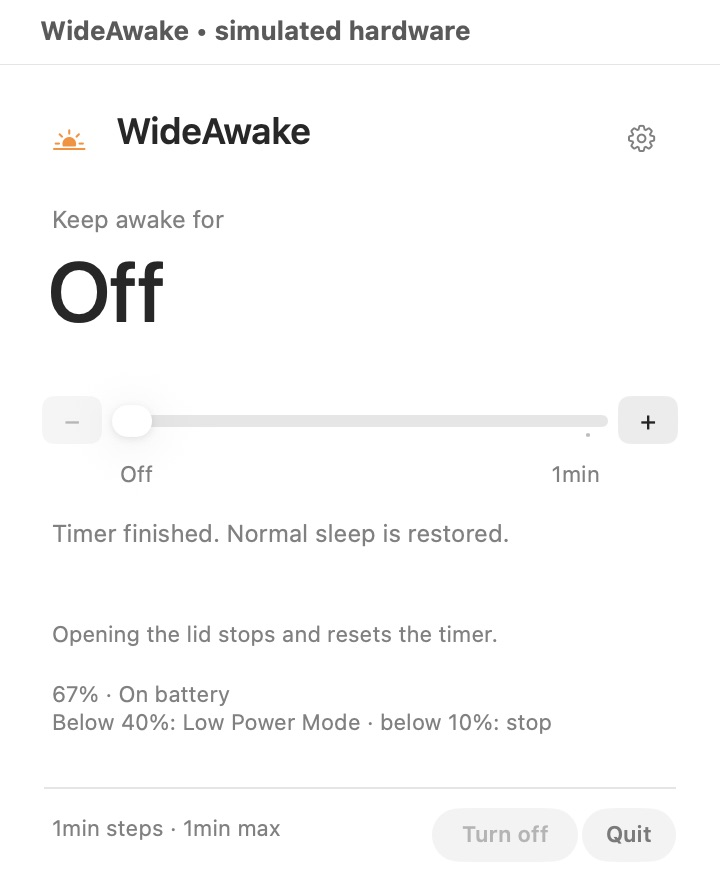

# Expiry observed, with effects simulated

This later unlocked desktop pass is separate from the [original 47-second deadline timeline](../native-case/README.md). Its figures and journals remain unchanged. The actual shipping AppKit panel reached Ready, Running and then Off with **“Timer finished. Normal sleep is restored.”** The shipping **Turn off** button also reset the timer; a separately injected lid-open event returned it to Off. Escape/panel reopening and a fresh controlled-host launch were observed.

[Ready capture](ready.png) · [reset capture](reset.png) · [successful raw transitions](green-journey.json) · [source and capture provenance](provenance.json).

## The first clock failed

The [first follow-up record](red-journey.json) remained Running beyond its 15:03:12Z stored deadline. That private host sampled the mutable test clock every 0.2 seconds. The one-shot deadline callback can read a stale sample and return, so this record is not an expiry success. This is a limitation of that artificial clock, not an established shipping-product failure.

A separate host changed only its private `FixtureSupport.swift` clock closure from `clock: { c.now },` to `clock: { Date() },`. The shipping [SessionManager default](../../Sources/WideAwake/Core/SessionManager.swift) already reads `Date()` directly. No shipping UI, controller, manager or system-service implementation changed between runs. That corrected controlled host reached expiry after its 15:06:29Z stored deadline, then passed the separate Turn off and injected-open/reset checks. Before/after fixture hashes and all 28 shipping-source hashes are recorded in provenance.json. The historical native-case builder used the sampled fixture. The 0.3.1 builder applies this correction only in its copied private fixture; it now compiles the integrated recovery source, while these recorded follow-up runs retain their earlier source scope.

## Boundary of the result

The helper supplies simulated lid events; its controls are not WideAwake’s shipping UX. Sleep, power, audio, display, process and backstop services remain fake. The panel’s restoration message is observed text, **not proof of real sleep or power restoration**. The injected 67% battery and one-minute range are test values. Fresh controlled relaunch starts new disposable state and does not establish recovery of an installed live session. Both hosts were stopped; no actual lid, login item, macOS setting or power command was changed.

Physical closed-lid operation, real system restoration, battery/thermal behavior and installed-session recovery remain untested. This page is a source-linked evidence record, not a standalone app, native replay bundle or new hardware certification. The original [reader](../native-case/README.md#reader-and-limits) continues to verify its own historical record; it does not include this later case. [MIT license](../../LICENSE).
